  

# 📊 Awesome Custom Enterprise BI & Reporting

  
  
  
  
  
  

---

## 🚀 Top Custom Enterprise BI & Reporting Ecosystem

> **A curated catalog of enterprise SaaS solutions and open-source analytics platforms for business intelligence, governed self-service dashboards, semantic layers, and client-facing embedded reporting.**  
> *Last updated: March 2026*

Welcome to the **Awesome Custom Enterprise BI & Reporting** repository — the definitive directory and architectural guide comparing enterprise **SaaS suites** and self-hosted **open-source business intelligence engines**.

Whether you are architecting a multi-tenant embedded SaaS analytics solution, implementing governed metrics with dbt, or replacing prohibitive per-seat licensing models with self-hosted Kubernetes deployments, this list categorizes the top technologies across feature maturity, granular pricing structures, and real enterprise limits.

---

## 📑 Table of Contents
- [📈 Sector Overview & Market Dynamics](#-sector-overview--market-dynamics)
- [🏢 SaaS & Commercial Hosted Platforms](#-saas--commercial-hosted-platforms)
- [💻 Open-Source GitHub Projects](#-open-source-github-projects)
- [🛠️ Architecture & Decision Guide](#️-architecture--decision-guide)
- [🤝 How to Contribute](#-how-to-contribute)
- [💖 Support & Sponsorship](#-support--sponsorship)
- [⭐ Star History](#-star-history)
- [⚖️ Disclaimer](#️-disclaimer)

---

## 📈 Sector Overview & Market Dynamics

The global **Business Intelligence (BI) and analytics software market** is estimated at **$33 billion to $35 billion in 2025** and projected to exceed **$40 billion by 2026**, growing at a CAGR of ~10%–12% fueled by rapid enterprise cloud migration, lakehouse architectures (Snowflake, Databricks, BigQuery), and generative conversational AI. 

The sector is **moderately fragmented**: mega-cap tech titans (*Microsoft, Salesforce/Tableau, Google Cloud, SAP, IBM*) command dominant enterprise desktop and cloud footprints through ecosystem bundling. Concurrently, a vibrant ecosystem of specialized SaaS platforms and production-ready open-source challengers thrive by addressing developer-led requirements—including headless semantic layers, code-first analytics, low-latency streaming pivots, and zero per-seat licensing fees.

---

## 🏢 SaaS & Commercial Hosted Platforms

A side-by-side comparison of leading proprietary enterprise BI platforms, sorted by **company valuation / market capitalization (descending)**, detailing transparent starting costs and free evaluation boundaries:

| Product | Valuation / Company Size | Description | Pricing (Starting) | Free Tier / Trial Limits |
|---------|--------------------------|-------------|-------------------|--------------------------|
| **[Microsoft Power BI](https://powerbi.microsoft.com/)** | ~$3.1T Market Cap (Microsoft) | Enterprise BI suite offering deep integration with Azure, Microsoft 365, and Fabric. Excellent for enterprise-wide Microsoft-stack reporting. | $14/user/month (Pro); $24/user/month (Premium Per User) | **Free forever**: Power BI Desktop (local authoring only, no cloud publishing/sharing); **60-day trial** for Pro/Premium |
| **[Looker (Google Cloud)](https://looker.com/)** | ~$2.1T Market Cap (Alphabet) | Enterprise semantic modeling BI platform centered around LookML for governed data logic, version control, and consistent metric definitions. | $5,000/month (Standard Platform base with 10 Standard + 2 Developer users) | **No free forever tier**; **30-day trial** (via Google Cloud console / sales evaluation with $300 GCP trial credit) |
| **[Tableau](https://www.tableau.com/)** | ~$280B Market Cap (Salesforce) | Gold standard for visual exploration and analyst drag-and-drop dashboarding, deeply integrated with Salesforce Data Cloud. | $15/user/month (Viewer, billed annually); minimum 1 Creator required at $75/user/month | **Free forever**: Tableau Public (for publicly shared dashboards only); **14-day trial** for full Tableau Cloud/Creator |
| **[SAP Crystal Reports](https://www.sap.com/)** | ~$270B Market Cap (SAP SE) | Established pixel-perfect reporting engine built for generating highly formatted, paginated, and printable operational documents. | $495 one-time per user (Named User License) | **No free forever tier**; **30-day trial** (full report designer features) |
| **[IBM Cognos Analytics](https://www.ibm.com/products/cognos-analytics)** | ~$200B Market Cap (IBM) | Legacy and cloud enterprise BI suite providing automated report authoring, AI-assisted data exploration, and enterprise governance. | $11.25/user/month (Standard On-Demand Cloud tier) | **No free forever tier**; **30-day trial** (up to 5 Premium users, full capabilities) |
| **[Qlik Sense](https://www.qlik.com/)** | ~$10B Valuation (Thoma Bravo PE) | Associative analytics engine with in-memory indexing, ideal for finding unpredicted relationships across disparate datasets. | $300/month (Starter tier, includes 10 users and 10 GB data) | **No free forever tier**; **30-day trial** (full Qlik Cloud Analytics features, no credit card required) |
| **[Sisense](https://www.sisense.com/)** | ~$1.1B Valuation (Private / Late-stage) | Embedded analytics engine and Compose SDK tailored for product engineering teams delivering customer-facing dashboards. | $3,000/month (Entry/Essential tier, billed annually ~$36,000–$40,000/year) | **No free forever tier**; **7-day trial** (full access to cloud test drive, no credit card required) |
| **[Domo](https://www.domo.com/)** | ~$160M Market Cap (NASDAQ: DOMO) | Full-stack cloud BI with native connectors, visual ETL data pipelines, real-time alerting, and executive mobile applications. | $2,500/month (Base consumption tier starting ~$30,000/year for data credits, unlimited users) | **No free forever tier**; **30-day trial** (full platform access with unlimited users, no credit card required) |
| **[GoodData](https://www.gooddata.com/)** | ~$60M Annual Rev / Private (~$350M raised) | Cloud analytics and multi-tenant semantic layer platform optimized for B2B SaaS application embedding. | $1,000/month (Professional tier with multi-tenant workspaces, unlimited users) | **No free forever tier**; **30-day trial** (full GoodData Cloud access, no credit card required) |

---

## 💻 Open-Source GitHub Projects

Community-driven, open-source BI engines and semantic layers sorted by **GitHub_Stars (descending)**. Every project includes a live Stars_Badge linking directly to its stargazers page:

| Project | Stars_Badge | Description |
|---------|------------|-------------|
| **[Apache Superset](https://github.com/apache/superset)** |  | **The enterprise-grade open-source BI platform** (~75,500 stars, Apache-2.0). Ships with 40+ visualization types, a powerful SQL IDE, no-code chart builder, and custom visualization plugins. **Superset provides row-level security (RLS), dashboard embedding, and enterprise SSO completely free.** Connects to any SQL dialect at petabyte scale. |
| **[Metabase](https://github.com/metabase/metabase)** |  | **The user-friendly self-service BI tool** (~50,300 stars, AGPL). The open-source edition is free with unlimited users, questions, and dashboards across 20+ data sources (Postgres, BigQuery, Snowflake, ClickHouse). Features visual query builders, SQL editor, and automated email/Slack alerts. |
| **[Redash](https://github.com/getredash/redash)** |  | **SQL-first BI & visualization platform** (~28,900 stars, BSD-2). Provides interactive query authoring with autocomplete, multi-chart dashboards, automated alert triggers, and comprehensive REST APIs. |
| **[DataEase](https://github.com/dataease/dataease)** |  | **Open-source Tableau alternative** (~24,700 stars, GPL-3.0). Modern web-based data visualization and dashboard platform with drag-and-drop authoring, multi-data source connectivity, dataset modeling, and embedded sharing. |
| **[Cube](https://github.com/cube-js/cube)** |  | **Universal semantic layer & embedded analytics engine** (~21,200 stars, Apache-2.0). Provides centralized data modeling, access control, caching/pre-aggregations, and SQL/REST/GraphQL APIs to power enterprise BI dashboards and customer-facing apps. |
| **[Perspective](https://github.com/perspective-dev/perspective)** |  | **High-performance streaming analytics & reporting engine** (~11,400 stars, Apache-2.0). Originally created at J.P. Morgan, built in C++/WebAssembly for hyper-fast, interactive pivot tables and real-time streaming data visualization. |
| **[JimuReport](https://github.com/jeecgboot/jimureport)** |  | **Enterprise reporting & dashboard builder** (~8,600 stars). Web-based drag-and-drop designer for complex enterprise print/export reports, operational dashboards, big-screen data displays, and barcode/QR reporting with JimuChatBI natural language queries. |
| **[Evidence](https://github.com/evidence-dev/evidence)** |  | **Business intelligence as code** (~7,100 stars, MIT). Build fast, interactive reports and analytical applications using SQL and Markdown. Version-controlled in Git, rendered statically or deployed to serverless hosts. |
| **[Lightdash](https://github.com/lightdash/lightdash)** |  | **The BI platform built for dbt** (~6,200 stars, MIT). Translates existing dbt models into self-service dashboards without raw SQL—using dbt YAML as the semantic single source of truth with version-controlled metric governance. |
| **[Rill](https://github.com/rilldata/rill)** |  | **Fast code-first operational BI** (~3,000 stars, Apache-2.0). Powered by DuckDB and ClickHouse, Rill defines data models, metrics, and interactive dashboards as code files for low-latency operational exploration. |
| **[Helical Insight](https://github.com/helicalinsight/helicalinsight)** |  | **Open-source framework for custom BI & reporting** (~1,100 stars). Supports AI conversational analytics, pixel-perfect paginated reports, interactive dashboards, multi-tenancy, and row-level security. |

---

## 🛠️ Architecture & Decision Guide

When building or scaling enterprise reporting environments, consider these core architectural paradigms:

- **Governed Self-Service at Scale**: **[Apache Superset](https://github.com/apache/superset)** is the undisputed open-source standard if your organization requires row-level security (RLS), enterprise SSO, and SDK embedding without recurring license fees.
- **Fast Non-Technical Adoption**: **[Metabase](https://github.com/metabase/metabase)** delivers the fastest time-to-value for business teams exploring data independently without needing advanced SQL knowledge.
- **Metrics as Code & dbt Ecosystem**: **[Lightdash](https://github.com/lightdash/lightdash)** and **[Evidence](https://github.com/evidence-dev/evidence)** allow data teams to manage semantic models and analytics directly within Git repositories alongside CI/CD workflows.
- **High-Performance Headless Analytics**: **[Cube](https://github.com/cube-js/cube)** acts as the universal semantic and pre-aggregation caching layer connecting raw data warehouses to custom customer-facing frontends.
- **Pixel-Perfect Paginated Reporting**: Tools like **[JimuReport](https://github.com/jeecgboot/jimureport)** and **[Helical Insight](https://github.com/helicalinsight/helicalinsight)** fill the critical operational reporting gap that visual dashboard-first tools leave open.

---

## 🤝 How to Contribute

Contributions to this ecosystem catalog are warmly welcomed! 

1. 🍴 **Fork** this repository.
2. 🌿 **Create a branch** for your addition (`git checkout -b add-tool-name`).
3. 📝 **Add/update** the entries in `README.md` adhering to the table format (include official links, factual starting pricing, exact trial/free-tier boundaries, or GitHub Stars_Count badges).
4. 🚀 **Submit a Pull Request** with a brief summary explaining the addition.

---

## 💖 Support & Sponsorship

If you find this curated enterprise resource valuable for your architecture planning or technical evaluations, please consider supporting the project:

- ⭐ **Star this repository** to help others discover it on GitHub.
- 🍴 **Fork and share** with your data team, platform engineers, and colleagues.
- ☕ **Sponsor the maintainer** or buy a coffee via the [GitHub Sponsor Dashboard](https://github.com/sponsors/ishandutta2007).

Your sponsorship helps keep this catalog independently verified, benchmarked, and updated with active tooling. Thank you for your support! 🙌

---

## ⭐ Star History

---

## ⚖️ Disclaimer

- This is an independent, community-curated directory — listed products are neither sponsored endorsements nor exhaustive guarantees.
- Enterprise BI environments handle sensitive corporate metrics, PII, and financial records. Always enforce row-level security (RLS), multi-factor authentication (MFA/SSO), role-based access control (RBAC), and rigorous audit logging.
- Pricing models and open-source licensing terms change over time. Verify current commercial agreements on each respective vendor's official pricing portal before procurement.

---

  <b>Built with ❤️ for data engineers, BI architects, and analytics platform teams.</b>

